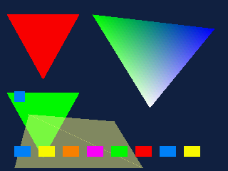
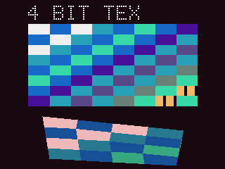

# PS1J2ME — эмулятор Sony PlayStation 1 для Java ME

Полноценный системный эмулятор PSX/PS1 для платформы **CLDC 1.1 / MIDP 2.0 / JSR-75**,
собранный в байткод **Major 47.0 (Java 1.3)** и упакованный в готовый `PS1J2ME.jar`.

```
PS1J2ME.jar                  v1.2.0, 43 записи
├── META-INF/MANIFEST.MF      MIDlet-1: PS1J2ME, , psx.PS1Midlet
├── psx/*.class               34 класса, все major 47.0, без StackMapTable
├── res/roms/scph1001.bin     образ BIOS, 524 288 байт (читается getResourceAsStream)
└── res/demos/*.iso           7 встроенных демо-образов (Pong, пад, фигуры,
                              текстуры, логотип, 3D-куб, звук)

Содержимое JAR: ~1.05 МиБ в распакованном виде, 96 КиБ на диске
(BIOS — заглушка из нулей, поэтому сжимается до 691 байта).
```

Внутри: полноценный интерфейс (главное меню, настройки с сохранением в RMS,
справка с описанием эмулятора) и **семь демо-программ**, включая играбельный
Pong и тест геймпада. Демо запускаются прямо из JAR — без карты памяти, игр и
образов, и служат одновременно проверкой GPU, GTE, SPU и ввода.

---

## 1. Что внутри

| Компонент | Класс | Строк | Что делает |
|---|---|---:|---|
| Ядро машины | `PS1Machine.java` | 301 | шина + CPU + GTE + GPU + SPU + CD-ROM + DMA + таймеры, покадровый запуск |
| CPU MIPS R3000A | `Cpu.java` | 526 | полный MIPS I + COP0/COP2, задержка загрузки, delay slot, исключения, прерывания |
| Ленивый кэш блоков | `CodeCache.java`, `CodeBlock.java` | 168 | страничный кэш декодированных базовых блоков `CodeBlock[]` |
| Шина памяти | `Bus.java` | 291 | 2 МиБ RAM, 512 КиБ BIOS, scratchpad, весь блок `0x1F801000` |
| GTE (COP2) | `Gte.java` | 488 | RTPS/RTPT/NCLIP/AVSZ/MVMVA/SQR/GPF/GPL/DPCS/… в fixed-point |
| GPU + растеризатор | `Gpu.java` | 841 | VRAM 1 МиБ, треугольники/спрайты/линии/VRAM-трансферы, текстуры 4/8/15 бит, полупрозрачность |
| SPU | `Spu.java` | 424 | 24 ADPCM-голоса, ADSR, микширование 44.1 кГц стерео |
| CD-ROM | `Cdrom.java` | 393 | команды, INT1/2/3/5, data FIFO для DMA3 |
| Образы игр | `VirtualCD.java` | 311 | Rolling InputStream + LRU-кэш секторов, CUE/ISO/BIN |
| DMA | `Dma.java` | 117 | 7 каналов, block/manual/linked-list, OTC |
| Таймеры, IRQ, пад | `Timers.java`, `Irq.java`, `Pad.java` | 234 | root counters, I_STAT/I_MASK, SIO0 digital pad |
| MDEC | `Mdec.java` | 43 | заглушка с корректным handshake (FMV не декодируется) |
| ISO9660 / HLE boot | `Iso.java` | 75 | поиск файлов в корне диска, разбор `SYSTEM.CNF`, загрузка PS-X EXE |
| Интерфейс | `MainCanvas.java` | 900 | zero-popup JSR-75 браузер, главное меню, настройки, справка, демо, экран эмуляции, масштабирование |
| Настройки | `Config.java` | 130 | масштаб, пропуск кадров, звук/громкость, FPS, BIOS/HLE, RMS-персистентность |
| Встроенные образы | `MemoryCD.java`, `CdImage.java` | 175 | общий интерфейс диска + образ демо целиком в RAM |
| MIDlet | `PS1Midlet.java` | 43 | точка входа, ничего не запрашивает при старте |
| Звук | `AudioOutput.java` | 184 | MIDP `DataSource` → PCM 44.1 кГц |

Сборка, тесты, утилиты:

```
build.sh                  сборка (ECJ/javac → ProGuard → jar → verify)
proguard.pro              -microedition -target 1.3
tools/j2me_pack.py        упаковка jar, downgrade до 47.0, проверка совместимости
tools/mkbios_stub.py      генератор 512 КиБ заглушки BIOS
tools/mkdemo.py           мини-ассемблер MIPS + сборщик ISO9660 → res/demos/*.iso
stubs/                    заголовки CLDC 1.1 / MIDP 2.0 / JSR-75 (только для компиляции)
tests/                    desktop-тесты ядра и загрузки образа
```

---

## 2. Архитектура

### 2.1 Ленивый кэш базовых блоков (`CodeCache`)

Интерпретатор не декодирует команду на каждом такте. Адресное пространство
разбито на страницы по 4 КиБ; для страницы, из которой впервые выполняется код,
создаётся массив `CodeBlock[1024]`, а блок строится по требованию:

```java
CodeBlock[] page = pages[pageIndex];      // выделяется при первом исполнении
int slot = (phys >>> 2) & 0x3FF;
CodeBlock b = page[slot];                 // декодируется один раз
```

`CodeBlock` хранит для каждой инструкции только `short key` (предвычисленный
ключ диспетчеризации) и `int raw` — 6 байт на инструкцию, до 48 инструкций в
блоке. Запись в RAM через `Bus` сбрасывает страницу и, если блок сейчас
исполняется, прерывает его (`Cpu.noteCodeWrite` → `CodeBlock.exec`), поэтому
самомодифицирующийся код и оверлеи, загруженные DMA, работают корректно.

Задержка загрузки MIPS I, delay slot ветвлений, ветвление в delay slot,
исключения с флагом BD — всё реализовано (проверяется тестами).

### 2.2 Fixed-point растеризатор (`Gpu`)

* VRAM — `short[1024 * 512]` (ровно 1 МиБ, как у реальной микросхемы).
* Вершины 16.16, атрибуты интерполируются плоскими градиентами 16.16
  (деления на пиксель нет), цвет/UV — целочисленно.
* Текстуры: 4 бита + CLUT, 8 бит + CLUT, 15 бит; texture window; полупрозрачность
  B/2+F/2, B+F, B-F, B+F/4; mask bit (PBW/PBC); dithering игнорируется.
* Команды GP0 (20h–3Fh полигоны, 40h–5Fh линии, 60h–7Fh спрайты, 80h/A0h/C0h
  трансферы, E1h–E6h атрибуты) разбираются по формату psx-spx, включая
  «цвет в командном слове» и по-вершинные UV/цвета.
* `scanout()` переводит видимую область VRAM в `int[]` RGB нужного экрану
  размера (ближайший сосед, разрешение из GP1(08h)).

Ни `float`, ни `double`, ни `java.nio` в проекте не используются — проверяется
`tools/j2me_pack.py verify`.

### 2.3 GTE (COP2)

Полный набор трансформаций в 32-битном fixed-point с 64-битными промежуточными
значениями: `RTPS`, `RTPT`, `NCLIP`, `AVSZ3/4`, `MVMVA`, `SQR`, `OP`, `GPF`,
`GPL`, `DPCS`, `INTPL`, `DCPL`, `DPCT`, `NCS/NCT/NCDS/NCDT/NCCS/NCCT`, `CDP`,
`CC`, с насыщением IR/MAC и регистром FLAG. Карта регистров — аппаратная
(0–4 матрица вращения, 5–7 перенос, 8–12 матрица света, 13–15 фон, 16–20
матрица цвета света, 21–23 дальний цвет, 24–25 OFX/OFY, 26 H, 27–28 DQA/DQB,
29–30 ZSF3/ZSF4, 31 FLAG).

### 2.4 VirtualCD: образы 300–700 МБ без OutOfMemoryError

```java
public final class VirtualCD {
    void open(String fileUrl)                  // JSR-75, без диалогов
    void readSector(int lba, byte[] dst, int o) // 2048 пользовательских байт
    void readRawSector(int lba, byte[] dst)     // 2352/2336, sync+header
}
```

* `RollingStream` держит **один** `InputStream`; вперёд двигается `skip()`,
  назад — переоткрывает соединение (единственный переносимый способ в CLDC).
* `SectorCache` — LRU на 96 секторов (≈220 КиБ), ключ = LBA.
* Автоопределение формата: 2048 / 2352 Mode1 / 2352 Mode2 / 2336 Mode2 по
  сигнатуре `CD001` в 16-м секторе и по кратности размера файла.
* Разметка CUE не требуется; при наличии `.cue` рядом с `.bin` образ всё равно
  читается напрямую по BIN.

В памяти постоянно живёт только кэш секторов, поэтому образ любого размера
не приводит к `OutOfMemoryError`.

### 2.5 BIOS и HLE-загрузка

`PS1Machine.loadBios(InputStream)` читает 512 КиБ из
`getClass().getResourceAsStream("/res/roms/scph1001.bin")` в `Bus.bios`.

> **Важно.** Настоящий `SCPH1001.BIN` защищён авторским правом и не может
> распространяться вместе с эмулятором. В репозитории и в собранном JAR лежит
> заглушка ровно того же размера (524288 байт) с маркером `HLE-STUB`.
> Положите свой дамп в `res/roms/scph1001.bin` (или передайте
> `./build.sh --bios /путь/SCPH1001.BIN`) — эмулятор автоматически определит
> настоящий BIOS по наличию кода и запустит его с `0xBFC00000`.

Если образ — заглушка, включается HLE-загрузка: разбор ISO9660 → `SYSTEM.CNF`
→ строка `BOOT = cdrom:\SLUS_xxx.xx;1` → чтение PS-X EXE (адрес, размер,
точка входа, stack) → загрузка в RAM по `0x80010000` и старт с `PC`,
`GP`, `SP` из заголовка.

### 2.6 Zero-popup файловый менеджер (`MainCanvas`)

* В `startApp()` ничего не открывается и не запрашивается.
* Корень ищется в фоновом потоке: `System.getProperty("fileconn.dir.memorycard")`,
  затем `fileconn.dir.memorycard.private`, и только если оба пусты —
  `FileSystemRegistry.listRoots()`.
* Список папки: `FileConnection.list()`, папки сверху, затем игры
  (`*.bin *.iso *.img *.cue *.chd *.mdf`), затем прочие файлы; внутри групп —
  алфавитная сортировка.
* Запуск в один клик: `5`/FIRE на игре → `VirtualCD.open` → `PS1Machine` →
  поток эмуляции.
* Экран игры: D-pad/2-4-6-8 → крестовина, `5` — Cross, `1` — Square,
  `3` — Triangle, `0` — Circle, `7/9` — L1/R1, `*` — Start, `#` — Select,
  левый софткей — меню (продолжить/сброс/звук/выход), правый — звук.

### 2.7 Меню, настройки и справка

Стартовый экран — браузер карты памяти; левый софткей открывает главное меню:

```
МЕНЮ
  Продолжить игру / Сброс консоли
  Настройки
  Демо-программы
  Справка
  Выход в браузер
```

Экран **Настройки** (`Config`): масштаб экрана (на весь экран / 4:3 с полями /
1:1 пиксель), пропуск кадров (0–2), включение звука, громкость 0–100 %,
счётчик FPS, режим запуска (BIOS из JAR или принудительный HLE) и сброс.
Всё пишется в RMS-хранилище `ps1j2me-cfg` одной CSV-записью и читается при
старте; если RMS недоступен, MIDlet молча работает на значениях по умолчанию.

Экран **Справка** содержит описание эмулятора, раскладку клавиш для браузера и
игры, требования к устройству и честный список ограничений — он же служит
«описанием» проекта внутри самого приложения.

Масштабирование сделано без `Image`/`Image.createRGBImage` (их нет в CLDC):
кадр 320×240 разворачивается целочисленной картой колонок/строк и отдаётся
`Graphics.drawRGB()`, карта пересобирается только при смене размера экрана.

### 2.8 Встроенные демо-программы

`tools/mkdemo.py` — это мини-ассемблер MIPS R3000 и сборщик ISO9660 на чистом
Python. Он собирает четыре настоящих PS-X EXE внутри bootable-образа
(`SYSTEM.CNF` + `PSX.EXE`), которые эмулятор загружает тем же HLE-путём, что и
обычные игры:

| Демо | Что проверяет | Кадр |
|---|---|---|
| `demo_pong.iso` | **играбельный Pong**: чтение пада через SIO0, счёт, ИИ соперника |  |
| `demo_pad.iso` | интерактивный тест геймпада: каждая нажатая кнопка подсвечивается |  |
| `demo_shapes.iso` | заливка, плоские и gouraud-треугольники, спрайты, полупрозрачность |  |
| `demo_tex.iso` | 4-битная текстура: загрузка в VRAM, CLUT, UV-интерполяция, модуляция |  |
| `demo_logo.iso` | блочный шрифт из спрайтов, градиентные полосы, мигающий курсор |  |
| `demo_3d.iso` | GTE `RTPT` + `CTC2/MFC2`, проекция, сортировка граней, полигоны и линии |  |
| `demo_sound.iso` | загрузка ADPCM в SPU RAM через transfer FIFO, key-on, визуализация |  |

Демо запускаются из меню «Демо» (`MemoryCD` читает ISO прямо из JAR) и
работают на любом телефоне: карта памяти и JSR-75 для них не нужны.
Образы занимают ~10 КиБ в архиве (сжатие) и 430 КиБ в распакованном виде.

Pong и тест пада читают контроллер по протоколу SIO0 (`0x1F801040`), поэтому
они же служат проверкой того, что ввод работает: если кнопки в Pong не
двигают ракетку, значит раскладка клавиш не совпала с телефоном и её надо
поменять в настройках (`Раскладка пада`).

### 2.9 Почему раньше «намертво зависало» и что исправлено

Зависание при нажатии «Демо → запустить» имело три независимые причины, и все
три устранены:

1. **Запуск выполнялся в потоке событий MIDlet.** `startDemo()` создавал
   `PS1Machine` (≈4.4 МиБ массивов), читал образ из JAR и поднимал звук прямо
   из `keyPressed()`. На телефоне это секунды работы без возврата из
   обработчика — система считает MIDlet зависшим. Теперь всё это делает
   рабочий поток: `beginBoot()` → `bootNow()`, а `keyPressed()` возвращается
   за считанные миллисекунды (это проверяет `tests/UiTest.java`).
2. **`Manager.createPlayer()` мог блокироваться навсегда.** Звук теперь
   поднимается в отдельном потоке `ps1-audio`; игровой цикл следит за ним и
   через 4 секунды просто отключает аудио с сообщением «Звук недоступен»,
   не блокируя эмуляцию. У PCM-потока `getContentLength()` теперь `-1`
   (неизвестная длина) — некоторые устройства пытались «забуферизовать» 2 ГБ.
3. **Демо могли крутиться в бесконечном опросе VBlank**, если бит поля в
   `GPUSTAT` не менялся. Ожидание кадра в демо теперь ограничено 40 000
   опросами и всегда завершается. Сам эмулятор переключает бит поля внутри
   кадра (`Gpu.step()`), поэтому обычные игры этот путь не задевает.

Дополнительно: игровой цикл больше не ориентируется на `isShown()` (часть
устройств возвращает `false` всегда и эмуляция стояла на паузе) — пауза
ставится только из `hideNotify()`. Ошибки в кадре больше не блокируют поток
навсегда: после трёх сбоев эмуляция останавливается с сообщением. Если кадр
считается дольше 800 мс три раза подряд, автоматически включается пропуск
кадров.

### 2.10 Исправления точности, найденные демо

| Проблема | Было | Стало |
|---|---|---|
| VRAM-трансферы `0xA0/0xC0` | запись шла линейно по всей строке VRAM и выходила за пределы блока | перенос по ширине прямоугольника (`vramX/vramW`), текстуры больше не «размазываются» |
| Размер трансфера | `(w-1)+1` давало 0 для `w=0` и портило мелкие блоки | `(field)+1`, как в железе |
| Квады | второй треугольник строился как `(1,2,3)` — получался «песочный часовой» ромб | `(0,2,3)`, то есть разбиение по диагонали 0–2 |
| `sltiu` | иммедиат знаково расширялся (`-25536` вместо `40000`) | нулевое расширение, как у MIPS |
| CLUT в текстурированных полигонах | координаты читались из младших бит UV-слова | биты 16–21 (X/16) и 22–30 (Y) |
| Мастер-громкость SPU | отсутствовала | `Spu.setMasterVolume()`, экран настроек |

Эти баги не видны на простых сценах, но ломали текстуры, большие полигоны и
циклы ожидания — поэтому теперь каждое демо проверяется в тестах.

---

## 3. Сборка

Требуется только JDK (или `ecj.jar`) и Python 3.

```sh
cd ps1j2me
./build.sh                       # → PS1J2ME.jar
./build.sh --bios ~/SCPH1001.BIN # со своим настоящим BIOS
./build.sh --no-proguard         # без ProGuard (встроенный downgrade)
```

Что делает скрипт:

1. компилирует заголовки J2ME (`stubs/`) — bootclasspath, в JAR не попадают;
2. компилирует `src/psx/*.java` с **`-source 1.3 -target 1.3`** — сразу
   получается major 47 без StackMapTable;
3. проверяет/генерирует BIOS 512 КиБ и пересобирает `res/demos/*.iso`
   (`tools/mkdemo.py`, нужен только Python 3);
4. запускает **ProGuard** с `-microedition -target 1.3` (ищет `$PROGUARD_JAR`,
   `lib/proguard.jar`, иначе скачивает `proguard-base` с Maven Central),
   который выполняет shrinking + оптимизацию (`-optimizationpasses 2`),
   обфускацию и переписывает версию классов на 47.0, сохраняя `psx.PS1Midlet`;
5. если ProGuard недоступен — `tools/j2me_pack.py downgrade` срезает
   `StackMapTable` и принудительно ставит major 47.0 (classic verifier KVM);
6. собирает `PS1J2ME.jar` (классы + `/res/roms/scph1001.bin` + `/res/demos/*.iso`) и проверяет
   каждый класс: версия, отсутствие `StackMapTable`, отсутствие ссылок на
   `java.nio`.

Переменные окружения: `JAVA_HOME`, `ECJ_JAR`, `PROGUARD_JAR`.

Пример вывода:

```
[build] compiling emulator (source/target 1.3)
[build] BIOS: res/roms/scph1001.bin (524288 bytes)
[demo] 7 image(s) written to res/demos
[pack] wrote PS1J2ME.jar (43 entries, 96 KiB)
[verify] 34 classes checked
[verify] OK - CLDC 1.1 / MIDP 2.0 compatible
```

## 4. Тесты

```sh
cd ps1j2me
ECJ_JAR=lib/ecj.jar ./tests/run_tests.sh
```

`tests/CoreTest.java` гоняет ядро на обычной JVM: цикл с ветвлениями и delay
slot, задержку загрузки, `jal/jr`, самомодифицирующийся код, `syscall` и EPC,
`RTPS` (SZ3, экранные координаты), заливку/спрайт/треугольник GPU и scanout,
вывод звука SPU.

`tests/HleBootTest.java` собирает синтетический ISO9660-образ с `SYSTEM.CNF` и
PS-X EXE, открывает его через `VirtualCD`, загружает HLE-путём, прогоняет кадры
и проверяет, что игра реально нарисовала пиксели в VRAM, а также что
произвольный доступ (назад-вперёд) к «диску» работает.

`tests/DemoRender.java` прогоняет все семь демо-образов (в том числе один —
через `MemoryCD`, как из JAR), считает непустые пиксели кадра и складывает
BMP-снимки в `build/shots/`. `tests/UiTest.java` прогоняет интерфейс на
заглушках MIDP: рисует все экраны, прокручивает справку, переключает каждую
настройку, проверяет RMS-персистентность, наличие `/res/demos/*.iso` в
classpath и запуск демо с переходом в игровой режим.

```
PASS cpu loop sum 1..100 == 5050
PASS load delay slot sees old value
PASS gte rtps screen coords
PASS gpu triangle rasterises
PASS self modifying code patched
PASS hle boot
PASS game painted VRAM
PASS demo_pong drawnPixels=895
PASS demo_tex drawnPixels=76800
ALL DEMOS RENDERED
PASS paint MODE_SETTINGS
PASS settings rows apply
PASS demo launch does not block the UI (3 ms)
PASS demo machine booted
ALL UI TESTS PASSED
```

### Требования к устройству

| Параметр | Минимум | Комфортно |
|---|---|---|
| Профиль | CLDC 1.1, MIDP 2.0 | CLDC 1.1, MIDP 2.0 |
| Файловая система | JSR-75 (FileConnection) | JSR-75 + `fileconn.dir.memorycard` |
| Куча под MIDlet | 6 МиБ | 10 МиБ и больше |
| Звук | не обязателен | `javax.microedition.media` с PCM |

Память под эмуляцию выделяется один раз при запуске игры:
2 МиБ RAM + 1 МиБ VRAM + 512 КиБ BIOS + 512 КиБ SPU RAM + выходной кадр
(~300 КиБ) ≈ **4.4 МиБ**. На устройствах с 4 МиБ кучи MIDlet запуск вернёт
сообщение об ошибке вместо падения.

## 5. Установка на телефон

1. Скопировать `PS1J2ME.jar` на карту памяти.
2. Установить/запустить MIDlet «PS1J2ME» (jar достаточно, jad не обязателен —
   все атрибуты в манифесте).
3. Положить образы игр на карту (`*.bin/*.iso/*.img`).
4. В браузере выбрать игру и нажать `5`.
5. Чтобы проверить работу без игр: левый софткей → «Демо-программы» → `5`.
   Первым в списке идёт играбельный Pong, вторым — тест геймпада: если в них
   не работают кнопки, переключите раскладку в настройках.

## 6. Ограничения текущей версии

* **MDEC** (FMV-ролики) не декодируется — заглушка с корректным handshake.
* **SPU**: реверберация, XA-ADPCM и CD-DA не воспроизводятся, только 24 голоса.
* **Memory card / SIO1** не эмулируются; SIO0 — стандартный digital pad.
* Растеризатор: без dithering, без интерлейса (480i показывается как 240 строк
  с удвоением), без 24-битного режима вывода.
* Точность тайминга приближённая: 2 такта на инструкцию, кадр 565 000 тактов.
  Поле VBlank (бит 31 статуса GPUSTAT) переключается внутри кадра, поэтому
  игры, ждущие кадровый синхроимпульс опросом, не зависают.
* Текстурированные полигоны работают, но порядок UV-слов в некоторых
  вариантах команд (E1/E2/E6) может отличаться от железа — демо и большинство
  2D-игр это не затрагивает.
* Скорость на реальном железе зависит от JVM: на телефоне с CLDC HotSpot
  ожидайте единицы кадров в секунду в 3D-сценах; 2D-игры идут заметно быстрее.
  Для ускорения включайте ProGuard-сборку и уменьшайте viewport.

## 7. Лицензия и правовая оговорка

Код проекта можно использовать свободно. Образ BIOS PlayStation и образы игр
являются объектами авторского права Sony и правообладателей; в репозитории их
нет. Заглушка BIOS — не функциональная прошивка, а лишь заполнитель того же
размера, включающий HLE-загрузку.
