# PS1J2ME — эмулятор Sony PlayStation 1 для Java ME

Полноценный системный эмулятор PSX/PS1 для платформы **CLDC 1.1 / MIDP 2.0 / JSR-75**,
собранный в байткод **Major 47.0 (Java 1.3)** и упакованный в готовый `PS1J2ME.jar`.

```
PS1J2ME.jar                  v1.7.2, 48 записей, 134 763 байт
├── META-INF/MANIFEST.MF      MIDlet-1: PS1J2ME, , psx.PS1Midlet
├── psx/*.class               39 классов, все major 47.0, без StackMapTable
├── res/roms/scph1001.bin     образ BIOS, 524 288 байт (читается getResourceAsStream)
└── res/demos/*.iso           7 встроенных демо-образов (Pong, пад, фигуры,
                              текстуры, логотип, 3D-куб, звук)

Содержимое JAR: **131 КиБ на диске** — ресурсы `res/*` сжаты. Это принципиально:
у части телефонов лимит на JAR 512 КиБ или 1 МиБ, и «тяжёлая» сборка (1013 КиБ
без сжатия) не ставилась/не запускалась. Нужен распакованный архив — сборка с
флагом `tools/j2me_pack.py --store-res`.
```

Внутри: полноценный интерфейс (главное меню, настройки с сохранением в RMS,
справка с описанием эмулятора) и **семь демо-программ**, включая играбельный
Pong и тест геймпада. Демо запускаются прямо из JAR — без карты памяти, игр и
образов, и служат одновременно проверкой GPU, GTE, SPU и ввода.

---

## 1. Что внутри

| Компонент | Класс | Строк | Что делает |
|---|---|---:|---|
| Ядро машины | `PS1Machine.java` | 301 | шина + CPU + GTE + GPU + SPU + CD-ROM + DMA + таймеры, покадровый запуск |
| CPU MIPS R3000A | `Cpu.java` | 526 | полный MIPS I + COP0/COP2, задержка загрузки, delay slot, исключения, прерывания |
| Ленивый кэш блоков | `CodeCache.java`, `CodeBlock.java` | 168 | страничный кэш декодированных базовых блоков `CodeBlock[]` |
| Шина памяти | `Bus.java` | 291 | 2 МиБ RAM, 512 КиБ BIOS, scratchpad, весь блок `0x1F801000` |
| GTE (COP2) | `Gte.java` | 488 | RTPS/RTPT/NCLIP/AVSZ/MVMVA/SQR/GPF/GPL/DPCS/… в fixed-point |
| GPU + растеризатор | `Gpu.java` | 841 | VRAM 1 МиБ, треугольники/спрайты/линии/VRAM-трансферы, текстуры 4/8/15 бит, полупрозрачность |
| SPU | `Spu.java` | 424 | 24 ADPCM-голоса, ADSR, микширование 44.1 кГц стерео |
| CD-ROM | `Cdrom.java` | 393 | команды, INT1/2/3/5, data FIFO для DMA3 |
| Образы игр | `VirtualCD.java` | 493 | Rolling InputStream + LRU-кэш секторов, ISO/BIN, разбор CUE (включая Windows-пути) |
| DMA | `Dma.java` | 117 | 7 каналов, block/manual/linked-list, OTC |
| Таймеры, IRQ, пад | `Timers.java`, `Irq.java`, `Pad.java` | 234 | root counters, I_STAT/I_MASK, SIO0 digital pad |
| MDEC | `Mdec.java` | 43 | заглушка с корректным handshake (FMV не декодируется) |
| ISO9660 / HLE boot | `Iso.java` | 75 | поиск файлов в корне диска, разбор `SYSTEM.CNF`, загрузка PS-X EXE |
| Интерфейс | `MainCanvas.java` | 1791 | zero-popup JSR-75 браузер и выбор устройства, меню, настройки, справка, демо, экран эмуляции, масштабирование |
| Клавиши | `KeyMap.java` | 268 | универсальный слой ввода: цифры, ASCII, game actions, стрелки, софткеи, три раскладки |
| Устройства | `FileRoots.java` | 258 | поиск карты и памяти телефона без запросов прав: свойства, реестр, зондирование |
| Настройки | `Config.java` | 198 | масштаб, пропуск кадров, звук/громкость, FPS, BIOS/HLE, раскладка, фильтр файлов, последняя папка, RMS |
| Встроенные образы | `MemoryCD.java`, `CdImage.java` | 175 | общий интерфейс диска + образ демо целиком в RAM |
| MIDlet | `PS1Midlet.java` | 43 | точка входа, ничего не запрашивает при старте |
| Звук | `AudioOutput.java` | 184 | MIDP `DataSource` → PCM 44.1 кГц |

Сборка, тесты, утилиты:

```
build.sh                  сборка (ECJ/javac → ProGuard → jar → verify)
proguard.pro              -microedition -target 1.3
tools/j2me_pack.py        упаковка jar, downgrade до 47.0, проверка совместимости
tools/mkbios_stub.py      генератор 512 КиБ заглушки BIOS
tools/mkdemo.py           мини-ассемблер MIPS + сборщик ISO9660 → res/demos/*.iso
stubs/                    заголовки CLDC 1.1 / MIDP 2.0 / JSR-75 (только для компиляции)
tests/                    desktop-тесты ядра и загрузки образа
```

---

## 2. Архитектура

### 2.1 Ленивый кэш базовых блоков (`CodeCache`)

Интерпретатор не декодирует команду на каждом такте. Адресное пространство
разбито на страницы по 4 КиБ; для страницы, из которой впервые выполняется код,
создаётся массив `CodeBlock[1024]`, а блок строится по требованию:

```java
CodeBlock[] page = pages[pageIndex];      // выделяется при первом исполнении
int slot = (phys >>> 2) & 0x3FF;
CodeBlock b = page[slot];                 // декодируется один раз
```

`CodeBlock` хранит для каждой инструкции только `short key` (предвычисленный
ключ диспетчеризации) и `int raw` — 6 байт на инструкцию, до 48 инструкций в
блоке. Запись в RAM через `Bus` сбрасывает страницу и, если блок сейчас
исполняется, прерывает его (`Cpu.noteCodeWrite` → `CodeBlock.exec`), поэтому
самомодифицирующийся код и оверлеи, загруженные DMA, работают корректно.

Задержка загрузки MIPS I, delay slot ветвлений, ветвление в delay slot,
исключения с флагом BD — всё реализовано (проверяется тестами).

### 2.2 Fixed-point растеризатор (`Gpu`)

* VRAM — `short[1024 * 512]` (ровно 1 МиБ, как у реальной микросхемы).
* Вершины 16.16, атрибуты интерполируются плоскими градиентами 16.16
  (деления на пиксель нет), цвет/UV — целочисленно.
* Текстуры: 4 бита + CLUT, 8 бит + CLUT, 15 бит; texture window; полупрозрачность
  B/2+F/2, B+F, B-F, B+F/4; mask bit (PBW/PBC); dithering игнорируется.
* Команды GP0 (20h–3Fh полигоны, 40h–5Fh линии, 60h–7Fh спрайты, 80h/A0h/C0h
  трансферы, E1h–E6h атрибуты) разбираются по формату psx-spx, включая
  «цвет в командном слове» и по-вершинные UV/цвета.
* `scanout()` переводит видимую область VRAM в `int[]` RGB нужного экрану
  размера (ближайший сосед, разрешение из GP1(08h)).

Ни `float`, ни `double`, ни `java.nio` в проекте не используются — проверяется
`tools/j2me_pack.py verify`.

### 2.3 GTE (COP2)

Полный набор трансформаций в 32-битном fixed-point с 64-битными промежуточными
значениями: `RTPS`, `RTPT`, `NCLIP`, `AVSZ3/4`, `MVMVA`, `SQR`, `OP`, `GPF`,
`GPL`, `DPCS`, `INTPL`, `DCPL`, `DPCT`, `NCS/NCT/NCDS/NCDT/NCCS/NCCT`, `CDP`,
`CC`, с насыщением IR/MAC и регистром FLAG. Карта регистров — аппаратная
(0–4 матрица вращения, 5–7 перенос, 8–12 матрица света, 13–15 фон, 16–20
матрица цвета света, 21–23 дальний цвет, 24–25 OFX/OFY, 26 H, 27–28 DQA/DQB,
29–30 ZSF3/ZSF4, 31 FLAG).

### 2.4 VirtualCD: образы 300–700 МБ без OutOfMemoryError

```java
public final class VirtualCD {
    void open(String fileUrl)                  // JSR-75, без диалогов
    void readSector(int lba, byte[] dst, int o) // 2048 пользовательских байт
    void readRawSector(int lba, byte[] dst)     // 2352/2336, sync+header
}
```

* `RollingStream` держит **один** `InputStream`; вперёд двигается `skip()`,
  назад — переоткрывает соединение (единственный переносимый способ в CLDC).
* `SectorCache` — LRU на 96 секторов (≈220 КиБ), ключ = LBA.
* Автоопределение формата: 2048 / 2352 Mode1 / 2352 Mode2 / 2336 Mode2 по
  сигнатуре `CD001` в 16-м секторе и по кратности размера файла.
* Разметка CUE не требуется; при наличии `.cue` рядом с `.bin` образ всё равно
  читается напрямую по BIN.

В памяти постоянно живёт только кэш секторов, поэтому образ любого размера
не приводит к `OutOfMemoryError`.

### 2.5 BIOS и HLE-загрузка

`PS1Machine.loadBios(InputStream)` читает 512 КиБ из
`getClass().getResourceAsStream("/res/roms/scph1001.bin")` в `Bus.bios`.

> **Важно.** Настоящий `SCPH1001.BIN` защищён авторским правом и не может
> распространяться вместе с эмулятором. В репозитории и в собранном JAR лежит
> заглушка ровно того же размера (524288 байт) с маркером `HLE-STUB`.
> Положите свой дамп в `res/roms/scph1001.bin` (или передайте
> `./build.sh --bios /путь/SCPH1001.BIN`) — эмулятор автоматически определит
> настоящий BIOS по наличию кода и запустит его с `0xBFC00000`.

Если образ — заглушка, включается HLE-загрузка: разбор ISO9660 → `SYSTEM.CNF`
→ строка `BOOT = cdrom:\SLUS_xxx.xx;1` → чтение PS-X EXE (адрес, размер,
точка входа, stack) → загрузка в RAM по `0x80010000` и старт с `PC`,
`GP`, `SP` из заголовка.

### 2.6 Zero-popup файловый менеджер (`FileRoots` + `MainCanvas`)

* В `startApp()` ничего не открывается и не запрашивается — первый кадр рисуется
  сразу, поиск устройств идёт в фоновом потоке.
* Корни ищет `FileRoots.discoverRoots()`, и он не полагается на один источник:

  1. системные свойства `fileconn.dir.memorycard`, `fileconn.dir.memorycard.private`,
     `fileconn.dir.roots.names`, `fileconn.dir.games`, `fileconn.dir.private`,
     `fileconn.dir.photos/music/videos/...` — на MTK и «китайцах» именно они
     содержат настоящий путь к карте; значения могут быть списком через запятую
     или точку с запятой;
  2. `FileSystemRegistry.listRoots()` — по спецификации, но на половине телефонов
     возвращает `null` или корни, которые нельзя открыть;
  3. зондирование типовых путей `file:///E:/ … /A:/`, `/root1/`, `/root2/`,
     `/sdcard/`, `/mmc/`, `/MemoryCard/` — только если первые два источника пусты.

  Каждый кандидат проверяется реальным открытием и `list()`; мёртвые пути
  отбрасываются, дубликаты склеиваются, `Root.label` даёт «Карта памяти (E:)» или
  «Телефон (C:)». Никаких исключений наружу: `discoverRoots()` всегда возвращает
  (возможно пустой) `Vector`.
* Если устройств больше одного, показывается экран **Устройства** (`[*]`), и
  игрок сам выбирает карту или память телефона. Если карта не видна — `*` на
  экране сообщения повторяет поиск, `5` открывает встроенные демо.
* Список папки: `FileConnection.list()` (при отказе — `list("*", false)`), папки
  сверху `[D]`, затем игры `[G]` (`*.bin *.iso *.img *.cue`), затем (только при
  включённом «Показывать все файлы») прочие файлы; внутри групп —
  алфавитная сортировка без учёта регистра. Скрытые файлы с точкой не показываются,
  имён с завершающей косой чертой в списке нет, длинные имена укорачиваются с
  сохранением расширения, размер файла печатается справа.
* Запуск в один клик: `5`/FIRE на игре → `VirtualCD.open` → `PS1Machine` → поток
  эмуляции. Для `.cue` открывается сам CUE-лист (см. 2.17). Форматы CHD, MDF и
  NRG намеренно не попадают в список игр: их нельзя прочитать без декомпрессора,
  и лучше не показывать файл, чем упасть на нажатии.
* Текущая папка запоминается в RMS (`Config.lastUrl`) и открывается при следующем
  старте, если она ещё существует.
* Экран игры: клавиши транслирует `KeyMap` (см. 2.16), поэтому работают и
  джойстик, и блок цифр, и софткеи; левый софткей — меню, правый — звук.

### 2.7 Меню, настройки и справка

Стартовый экран — браузер карты памяти; левый софткей открывает главное меню:

```
МЕНЮ
  Продолжить игру / Сброс консоли
  Настройки
  Демо-программы
  Справка
  Диагностика
  Сменить папку с играми
  Выход в браузер
```

Список меню прокручивается (тонкая полоса справа), поэтому на экране 128x160
все пункты достижимы.

Экран **Настройки** (`Config`): масштаб экрана (на весь экран / 4:3 с полями /
1:1 пиксель), пропуск кадров (0–2), включение звука, громкость 0–100 %,
счётчик FPS, режим запуска (BIOS из JAR или принудительный HLE),
**раскладка кнопок** (стандарт / крест-круг / только цифры), показ всех файлов
и сброс.
Всё пишется в RMS-хранилище `ps1j2me-cfg` одной CSV-записью и читается при
старте; если RMS недоступен, MIDlet молча работает на значениях по умолчанию.

Экран **Справка** содержит описание эмулятора, раскладку клавиш для браузера и
игры, требования к устройству и честный список ограничений — он же служит
«описанием» проекта внутри самого приложения.

Экраны (сняты `tests/UiRender.java` на экране 176x208):

| Экран | Снимок | Экран | Снимок |
|---|---|---|---|
| Выбор устройства | 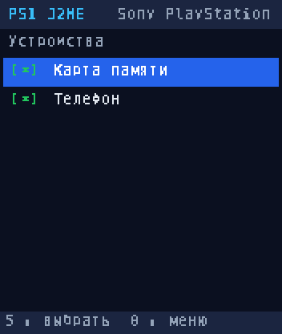 | Папка с играми | 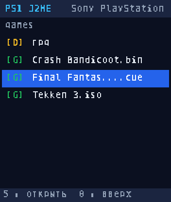 |
| Настройки | 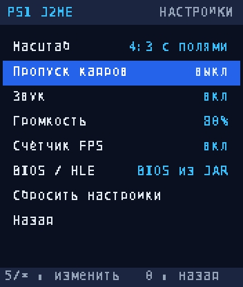 | Меню | 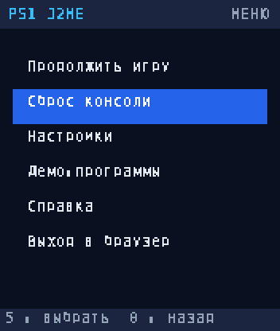 |
| Справка | 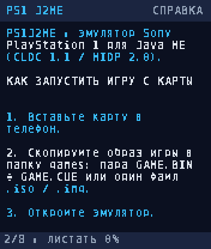 | Игра (демо Pong) | 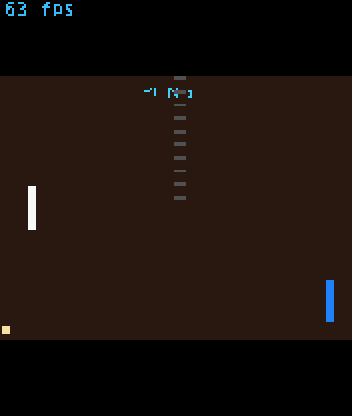 |

Масштабирование сделано без `Image`/`Image.createRGBImage` (их нет в CLDC):
кадр 320×240 разворачивается целочисленной картой колонок/строк и отдаётся
`Graphics.drawRGB()`, карта пересобирается только при смене размера экрана.

### 2.8 Встроенные демо-программы

`tools/mkdemo.py` — это мини-ассемблер MIPS R3000 и сборщик ISO9660 на чистом
Python. Он собирает четыре настоящих PS-X EXE внутри bootable-образа
(`SYSTEM.CNF` + `PSX.EXE`), которые эмулятор загружает тем же HLE-путём, что и
обычные игры:

| Демо | Что проверяет | Кадр |
|---|---|---|
| `demo_pong.iso` | **играбельный Pong**: чтение пада через SIO0, счёт, ИИ соперника | 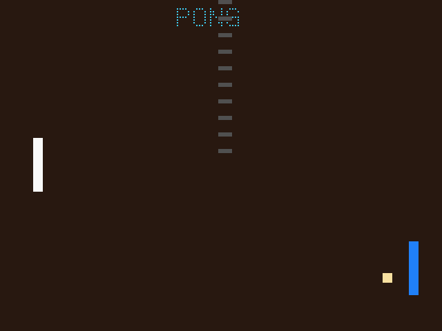 |
| `demo_pad.iso` | интерактивный тест геймпада: каждая нажатая кнопка подсвечивается | 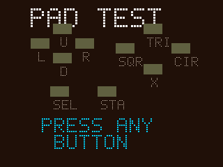 |
| `demo_shapes.iso` | заливка, плоские и gouraud-треугольники, спрайты, полупрозрачность | 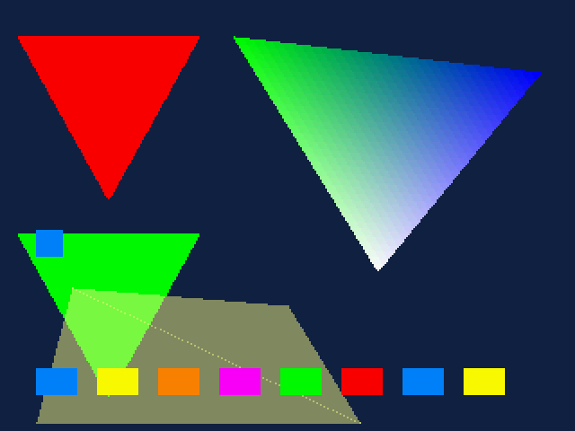 |
| `demo_tex.iso` | 4-битная текстура: загрузка в VRAM, CLUT, UV-интерполяция, модуляция |  |
| `demo_logo.iso` | блочный шрифт из спрайтов, градиентные полосы, мигающий курсор | 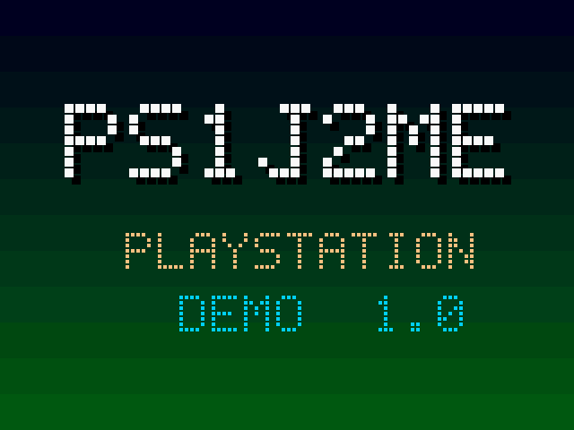 |
| `demo_3d.iso` | GTE `RTPT` + `CTC2/MFC2`, проекция, сортировка граней, полигоны и линии | 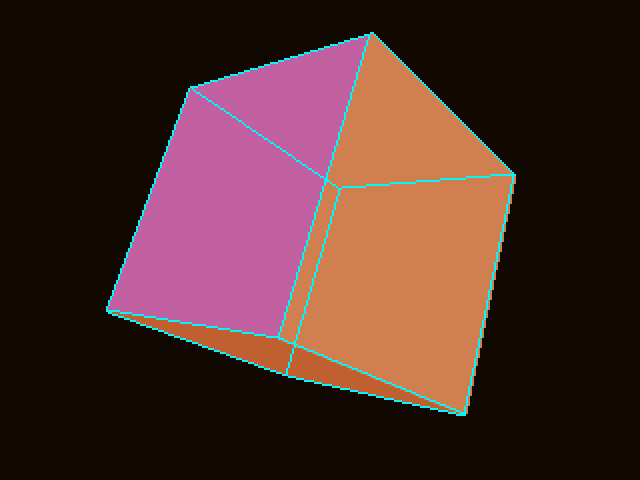 |
| `demo_sound.iso` | загрузка ADPCM в SPU RAM через transfer FIFO, key-on, визуализация |  |

Демо запускаются из меню «Демо» (`MemoryCD` читает ISO прямо из JAR) и
работают на любом телефоне: карта памяти и JSR-75 для них не нужны.
Образы занимают ~10 КиБ в архиве (сжатие) и 430 КиБ в распакованном виде.

Pong и тест пада читают контроллер по протоколу SIO0 (`0x1F801040`), поэтому
они же служат проверкой того, что ввод работает: если кнопки в Pong не
двигают ракетку, значит раскладка клавиш не совпала с телефоном и её надо
поменять в настройках (`Раскладка пада`).

### 2.9 Почему раньше «намертво зависало» и что исправлено

Зависание при нажатии «Демо → запустить» имело три независимые причины, и все
три устранены:

1. **Запуск выполнялся в потоке событий MIDlet.** `startDemo()` создавал
   `PS1Machine` (≈4.4 МиБ массивов), читал образ из JAR и поднимал звук прямо
   из `keyPressed()`. На телефоне это секунды работы без возврата из
   обработчика — система считает MIDlet зависшим. Теперь всё это делает
   рабочий поток: `beginBoot()` → `bootNow()`, а `keyPressed()` возвращается
   за считанные миллисекунды (это проверяет `tests/UiTest.java`).
2. **`Manager.createPlayer()` мог блокироваться навсегда.** Звук теперь
   поднимается в отдельном потоке `ps1-audio`; игровой цикл следит за ним и
   через 4 секунды просто отключает аудио с сообщением «Звук недоступен»,
   не блокируя эмуляцию. У PCM-потока `getContentLength()` теперь `-1`
   (неизвестная длина) — некоторые устройства пытались «забуферизовать» 2 ГБ.
3. **Демо могли крутиться в бесконечном опросе VBlank**, если бит поля в
   `GPUSTAT` не менялся. Ожидание кадра в демо теперь ограничено 40 000
   опросами и всегда завершается. Сам эмулятор переключает бит поля внутри
   кадра (`Gpu.step()`), поэтому обычные игры этот путь не задевает.

Дополнительно: игровой цикл больше не ориентируется на `isShown()` (часть
устройств возвращает `false` всегда и эмуляция стояла на паузе) — пауза
ставится только из `hideNotify()`. Ошибки в кадре больше не блокируют поток
навсегда: после трёх сбоев эмуляция останавливается с сообщением. Если кадр
считается дольше 800 мс три раза подряд, автоматически включается пропуск
кадров.

### 2.10 Исправления точности, найденные демо

| Проблема | Было | Стало |
|---|---|---|
| VRAM-трансферы `0xA0/0xC0` | запись шла линейно по всей строке VRAM и выходила за пределы блока | перенос по ширине прямоугольника (`vramX/vramW`), текстуры больше не «размазываются» |
| Размер трансфера | `(w-1)+1` давало 0 для `w=0` и портило мелкие блоки | `(field)+1`, как в железе |
| Квады | второй треугольник строился как `(1,2,3)` — получался «песочный часовой» ромб | `(0,2,3)`, то есть разбиение по диагонали 0–2 |
| `sltiu` | иммедиат знаково расширялся (`-25536` вместо `40000`) | нулевое расширение, как у MIPS |
| CLUT в текстурированных полигонах | координаты читались из младших бит UV-слова | биты 16–21 (X/16) и 22–30 (Y) |
| Мастер-громкость SPU | отсутствовала | `Spu.setMasterVolume()`, экран настроек |

Эти баги не видны на простых сценах, но ломали текстуры, большие полигоны и
циклы ожидания — поэтому теперь каждое демо проверяется в тестах.

---


### 2.14 HLE-эмуляция BIOS (`BiosHle`)

Даже с правильно загруженным `PSX.EXE` игра без BIOS не живёт: она вызывает
ядро через таблицы `A0/B0/C0` (`jal 0xA0`, номер функции в `r9`). Раньше такие
вызовы прыгали в нулевой вектор исключений — игра зависала.

Теперь `BiosHle` перехватывает обращения к векторам прямо в `Cpu.run()` и
отвечает из Java:

| Таблица | Что реализовано |
|---|---|
| `A(…)` | `printf` (полный разбор `%d %u %x %X %o %c %s %p` + ширина/точность), `puts/putchar/getchar`, `strlen/strcpy/strcat/strcmp/strncmp/strchr/strstr/strpbrk/strspn`, `memcpy/memset/memmove/memcmp/memchr/bcopy/bzero`, `atoi/strtol`, `rand/srand`, `malloc/calloc/realloc/free/InitHeap` (куча от `InitHeap`, по умолчанию `0x80100000`), файловые `open/read/lseek/close/putc/getc/ioctl/isatty` (чтение прямо из ISO через `Iso.findEntry`), `FlushCache`, `GetSysSp`, GPU-хелперы `GPU_dw`, `gpu_send_dma`, `SendGP1Command`, `GPU_cw`, `GPU_cwp`, `send_gpu_linked_list`, `gpu_sync`, `GetGPUStatus`, `exit/_exit` |
| `B(…)` | события `OpenEvent/CloseEvent/DeliverEvent/UnDeliverEvent/WaitEvent/TestEvent/EnableEvent/DisableEvent`, `alloc_kernel_memory`, таймеры, `InitPAD2/StartPAD2/StopPAD2` (пад подключён к `Pad`), `GetB0Table/GetC0Table`, `testdevice`, `_get_errno/_get_error`, файловые `B(32..3B)`, `exit` |
| `C(…)` | критические секции, `SysEnqIntRP/SysDeqIntRP`, обработчики исключений — безопасные заглушки, возвращающие 0 |
| `syscall` | `EnterCriticalSection`, `ExitCriticalSection`, `ChangeThreadSubFunction`, иначе `DeliverEvent(F0000010,4000)` |

Ничего не «падает»: неизвестная функция возвращает 0 и увеличивает счётчик
`unknownCalls`, который виден на экране «Диагностика».

### 2.15 Экран «Диагностика»

В меню паузы появился пункт **Диагностика** — снимок состояния, по которому
можно понять, что именно не работает на телефоне:

```
Версия 1.6.0          Экран 176x208        Память 60530 КиБ свободно
Режим HLE BIOS        Кадров 1234  fps 24  GPU пикселей 812345
Вывод GPU есть        Размер кадра 320x240  Диск cdrom:...
Секторов 12345        Звук есть            Масштаб 4:3 с полями
BIOS вызовов 91  неизвестных 0             BIOS: <последняя строка printf>
```

`*` обновляет снимок, `2/8` листают, `0` выходит.

### 2.13 «Игра не рисуется, нет GPU» — настоящая причина

Симптом: демо/игра запускается, эмулятор честно крутит кадры, но экран чёрный,
через несколько секунд появляется подсказка «нет вывода GPU».

Причина была в загрузке BIOS. В JAR лежит **заглушка** BIOS (заголовок Sony +
нули, `tools/mkbios_stub.py`), но `loadBios()` возвращала `true`, потому что
512 КиБ прочитаны успешно. `bootNow()` считал, что «BIOS есть», и **не вызывал
HLE-загрузчик**:

```
real = m.loadBios(bios);        // true, хотя это нули
if (!real && !m.hleBoot(image)) // никогда не выполнялось
```

CPU после сброса прыгал в BIOS, а там нули — то есть `nop` до бесконечности:
`framesRun` растёт, GPU пишет 0 пикселей, экран чёрный. Демо на десктопе
работали, потому что `DemoRender` вызывает `hleBoot()` напрямую.

Исправление в `MainCanvas.bootNow()`:

```java
real = m.loadBios(bios);
if (real && m.isHleMode()) real = false;   // заглушка/битый BIOS -> HLE
if (!real && !m.hleBoot(image)) failBoot(...);
```

Дополнительно:

* `Gpu.pixelsWritten` — счётчик реально записанных в VRAM пикселей;
  `PS1Machine.getPixelsWritten()` отдаёт его наружу;
* аварийный скан `Gpu.scanoutRaw()` — если 120 кадров нет вывода, кадр берётся
  из начала VRAM, минуя область вывода (игры, которые программа GP1(05h)
  которого мы ещё не декодируем, больше не «чёрные»);
* подсказка «нет вывода GPU» заменена на информационную строку
  `кадр N · fps · пикселей GPU` — сразу видно, рисует ли GPU вообще;
* в тесты добавлена регрессия: после запуска демо кадр обязан быть не чёрным,
  а `pixelsWritten > 1000` (`UiTest`, плюс `ui_game.bmp` из `UiRender`).

### 2.12 Текст: почему «пропадал» и как сделан встроенный шрифт

Причин было две, обе исправлены:

| Причина | Как проявлялась | Исправление |
|---|---|---|
| Компилятор читал исходники не как UTF-8 | В `MainCanvas` вся кириллица превращалась в `U+FFFD`: `Pong (�������)`, «Тест геймпада» → пустые прямоугольники. Экран меню выглядел как «текст пропал» | `build.sh` и `tests/run_tests.sh` компилируют с `-encoding UTF-8`; в `UiTest` добавлена проверка, что кириллица выжила |
| Системный шрифт телефона без кириллицы / игнорирование `setFont()` | `Graphics.drawString()` ничего не рисовал или рисовал огромным шрифтом, ломая вёрстку | весь UI рисуется собственным шрифтом `psx/TinyFont.java`: 170 глифов 5×7 (ASCII + кириллица + «»—…№°→), сгенерированных `tools/mkfont.py` из DejaVu Sans Mono |

Что даёт свой шрифт: одинаковый вид на всех аппаратах, гарантированная
кириллица, точная вёрстка (шаг 6 px, высота 8 px), обрезка длинных строк через
`TinyFont.ellipsize()` и перенос длинных строк справки по ширине экрана.
Bold заменён на цветовое выделение — при 5×7 «жирный» двойной проход
превращал кириллицу в кашу.

Скриншоты всех экранов (`ui_demos.png`, `ui_settings.png`, `ui_help.png`,
`ui_pause.png`, `ui_message.png`) снимаются тестом `tests/UiRender.java`:
он рисует Canvas в буфер и складывает BMP в `build/shots/`.

### 2.11 Чёрный экран при запуске — устранено

Жалоба «запускаю — чёрный экран» разобрана по трём причинам; все они закрыты:

| Причина | Что было | Что сделано |
|---|---|---|
| Пауза по `hideNotify()` | На части устройств `hideNotify()` приходит во время старта, эмулятор навсегда вставал на паузу с чёрным кадром | `hideNotify()`/`showNotify()` больше **не** меняют `paused`; пауза только из меню |
| `getClass()` в анонимном классе | `MemoryCD.fromResource(getClass(), …)` внутри `ImageFactory` отдавал внутренний класс, `/res/demos/…` не находился | якорь `final Class anchor = getClass()` берётся у самого `MainCanvas` |
| Молчаливый сбой кадра | `OutOfMemoryError` и серия исключений просто останавливали поток — экран оставался чёрным | `abortGame()` переводит в `MODE_MESSAGE` с читаемым текстом (память / сбой) вместо чёрного экрана |

Дополнительно:

* сторож `hasVisibleOutput()` проверяет кадр каждые 32 кадра; если 240 кадров
  подряд нет ни одного нечёрного пикселя — выводится подсказка
  «Игра не рисует кадры (нет вывода GPU)»;
* пока вывода нет, внизу экрана идёт строка `PS1J2ME: выполняется N кадр(ов) /
  старт эмуляции` — видно, что процесс жив;
* если `drawRGB()` бросает исключение (некоторые прошивки не принимают буфер
  `int[]`), включается `drawFrameFallback()` — отрисовка блоками 4×4 через
  `fillRect()`, медленно, но никогда не чёрный экран;
* `destRect()` больше не создаёт `int[4]` на каждый кадр (кэш + быстрый путь
  масштаба 1:1).

Демо Pong получило видимое игровое поле и заголовок — даже первый кадр не чёрный,
поэтому «чёрный экран» теперь визуально отличим от рабочего запуска.

### 2.16 Ввод на «китайцах», MTK и в J2ME Loader (`KeyMap`)

Одна и та же физическая кнопка приходит в MIDlet пятью разными способами, и
угадать заранее, каким именно на конкретной модели, невозможно:

| Способ | Пример |
|---|---|
| код цифры MIDP | `KEY_NUM2` = 50 |
| сырой ASCII (эмулированные устройства) | `50` как число символа |
| game action | `Canvas.UP`, `Canvas.FIRE` |
| псевдокод стрелки | `Canvas.KEY_UP`, `KEY_FIRE` |
| софткей | `KEY_SOFTKEY1..3` = `-6, -7, -8` |

`KeyMap.action(keyCode, action, layout)` принимает **все** варианты одновременно
и возвращает одно действие (`UP`, `CROSS`, `L1`, `MENU`, ...). Порядок разбора:
софткеи → блок цифр → game actions/стрелки. Блок цифр стоит раньше джойстика
намеренно: он работает практически на любом телефоне и на эмуляторах, поэтому
игра всегда остаётся управляемой.

Три раскладки (`Настройки → Раскладка кнопок`):

| Раскладка | Что делает | Кому |
|---|---|---|
| стандарт | Cross = 5, Circle = 0, джойстик включён | большинство телефонов и J2ME Loader |
| крест/круг | Cross и Circle меняются местами | игры, где подтверждение — круг |
| только цифры | джойстик отключён, работают только цифры и софткеи | MTK/китайские телефоны с кривыми кодами |

Меню намеренно **не** зависят от раскладки: `5` всегда подтверждает, `0` всегда
возвращает назад, `#` включает показ всех файлов, `*` обновляет список. Так
игрок, поменявший крест и круг ради игры, не теряет навигацию.

Конфликт кодов, который приходится решать в пользу меню: по MIDP 2.0
`KEY_SOFTKEY1..3` совпадают с `GAME_A..C` (`-6..-8`). Код не говорит, какая это
была кнопка, поэтому софткеи выигрывают — иначе на телефоне без свободных клавиш
меню было бы недостижимо. `KEY_FIRE` (`-5`) из этого списка исключён: на моделях,
которые его присылают, это настоящая кнопка огня. Средний софткей в игре работает
как Cross.

### 2.17 CUE-листы и `.cue`-only образы

На карте памяти чаще всего лежит пара `GAME.BIN` + `GAME.CUE`, причём в листе
нередко прописан абсолютный путь Windows (`FILE "D:\GAMES\GAME.BIN" BINARY`),
который на телефоне не существует. Поэтому `VirtualCD.open("…/game.cue")` сам
читает лист:

* `FILE` — берётся последний элемент пути (и `\`, и `/`), файл ищется рядом с
  `.cue`, затем пробуются `.bin/.BIN/.img/.iso` с тем же именем;
* `TRACK nn MODE1/2352 | MODE2/2352 | MODE2/2336 | MODE1/2048` — задаёт раскладку
  сектора (2352/2336/2048 и смещение пользовательских данных 16/24/8/0);
* если `TRACK` нет, раскладка определяется по сигнатуре `CD001` в секторе 16;
* комментарии `REM`, `INDEX`, `PREGAP`, `ISRC` игнорируются, читаются только
  первые 64 КиБ листа.

`getCueUrl()` и `getCueFile()` возвращают разобранный лист и имя полезного файла —
они видны на экране «Диагностика». Если файла из листа нет рядом, выдаётся
понятная ошибка («cue: нет файла …»), а не пустой экран.

### 2.18 Исправления 1.7.1

Восемь ошибок, найденных после 1.7.0. На каждую есть регрессионный тест,
который падает на 1.7.0 и проходит здесь.

| # | Что было | Что стало |
|---|---|---|
| 1 | в раскладке «крест/круг» кнопка `0` превращалась в Cross и **запускала игру** вместо возврата назад | меню используют `translateUi()` — раскладка применяется только к игровому паду; `5` подтверждает, `0` возвращает в любой раскладке |
| 2 | кнопка, зажатая при открытии меню, оставалась нажатой — после «Продолжить игру» персонаж бежал сам | `openPauseMenu()` вызывает `releasePad()`, а `keyReleased()` работает и вне игрового экрана |
| 3 | переключение «Показывать все файлы» выбрасывало из настроек в браузер | флаг `keepModeOnList` сохраняет `MODE_SETTINGS` при перечитывании папки |
| 4 | `.cue` с несколькими `FILE` (диск с CD-DA дорожкой в начале) открывал **аудио**-файл, игра не грузилась | берётся файл той дорожки, где найден первый data-трек; предусмотрен запасной вариант |
| 5 | `FileRoots.isUsable()` требовал `exists()` **и** `isDirectory()`; прошивки, где `isDirectory()` бросает исключение, теряли карту | достаточно успешно открыть и получить `list()`; `isDirectory()` — только подсказка |
| 6 | нажатие на не-игру в режиме «все файлы» молча ничего не делало | сообщение «Это не образ игры: …» — и оно действительно рисуется (полоса сообщений теперь общая для всех экранов, раньше жила только на игровом) |
| 7 | выход вверх из корня карты при единственном устройстве вёл на тупиковый экран «Устройства» | при одном корне сразу открывается меню |
| 8 | `*` на экране сообщения во время загрузки запускал второй поиск карты поверх загрузки | второй поиск заблокирован, показывается «Загрузка уже идёт, подождите…» |

Плюс улучшения браузера: в шапке счётчик игр («3 игры», «11 игр» — с правильным
русским склонением), пометка «обрезан», если в папке больше 512 записей, и
более понятная строка состояния.

Тестовые наборы выросли: `FileRootsTest` — 30 проверок (включая шим, бросающий
исключение из `isDirectory()`), `CueSheetTest` — 21 (mixed-mode лист),
`UiTest` — регрессии на пункты 1–3, 6–8, включая проверку, что текст сообщения
**попиксельно** доходит до экрана браузера.

### 2.19 Исправления 1.7.2

Раунд точности: пад, жизненный цикл мидлета и таблицы BIOS. Каждый пункт
закрыт тестом, который **падает на 1.7.1**.

| # | Что было | Что стало |
|---|---|---|
| 1 | `Pad` выставлял бит ACK навсегда и не сбрасывал «есть данные» после чтения | ACK — импульс 200 тактов (взводится в `process()`, гаснет в `step()`), бит готовности снимается при чтении `JOY_DATA`, кадр перезапускается по байту `0x01` **или** по спаду `/JOY` |
| 2 | `pauseApp()` был пустым: во время звонка эмуляция продолжала жечь CPU в фоне, звук играл, пад оставался зажатым | пауза эмуляции, меню паузы, `releasePad()`, остановка звука; возврат **не** возобновляет игру сам, «Продолжить игру» заново поднимает звук |
| 3 | `B(02) init_timer` ничего не программировал (возвращал 0), `B(04/05)` не трогали маску прерываний | таймеры программируются по документации: сброс режима, reload, расчёт `mode` из `flags` (бит4 → синхронизация, бит0 → источник тактов, бит12 → IRQ по target), `B(03)`/`B(06)` читают и сбрасывают счётчик, `B(04/05)` ставят и снимают биты в `I_MASK` |
| 4 | `B(0C/0D) Enable/DisableEvent` возвращали 0 (ядро всегда возвращает 1); `B(15) PAD_init2`, `B(51) Krom2RawAdd`, `B(59) testdevice` были заглушками | возвраты по документации: 1 для событий, 2 для `PAD_init2` с типом `0x20000000/1`, −1 для `Krom2RawAdd` (в HLE нет шрифта BIOS), `testdevice` знает `cdrom`/`tty` и честно отвечает «нет» про карту памяти |
| 5 | TAB-таблица C была почти пустой (`0x04`, `0x05`, `0x1D` → 0), остальное молча возвращало 0 | полная таблица C: `EnqueueTimerAndVblankIrqs`, `SysEnqIntRP`, `InstallExceptionHandlers`, `SysInitMemory` (регион реально используется `B(00)`), `SysInitKernelVariables`, `ChangeClearRCnt` (возвращает **прежний** флаг), `InitDefInt`, `SetIrqAutoAck`, `InstallDevices`, `_circgetc` (−1), `set/get_card_find_mode`; несуществующие номера уходят в диагностику как `C(nn)` |
| 6 | встроенное демо Pong двигало ракетку, когда кнопка **не** нажата | пад читается active-low, как в документации; `GameFlowTest` жмёт UP/DOWN и проверяет пиксель |
| 7 | `wait_vblank()` в генераторе демо уходил назад по ветке «поле переключилось», поэтому все демо рисовали кадр через раз — половина скорости | ветвление на выход по факту переключения, страховка по счётчику опросов остаётся сверху |
| 8 | `draw_number()` занимал `t1` — регистр с базой GP0; следующие записи в GPU уходили на адрес 1..5 и поднимали ADES-исключение (22 исключения за прогон демо) | `gp0()` сам загружает базу GP0 перед каждой записью |

Новый набор `tests/GameFlowTest.java` проходит весь путь целиком: образ
`demo_pong.iso` из classpath → `MemoryCD` → HLE-загрузчик → CPU → **биты пада
→ логика игры → пиксели в VRAM**. 13 проверок, включая «картинка меняется от
кадра к кадру», «удержание DOWN двигает ракетку», «отпустил — встала» и
«за прогон не было ни одного исключения». На прошлых демо-образах он падает
4 из 13.

`tests/KtableTest.java` — 70 проверок таблиц A/B/C: возвраты, состояние
(`ChangeClearRCnt`, card-find-mode, `SysInitMemory` + `alloc_kernel_memory`),
реальное программирование таймеров (режим `0x148`, `I_MASK` биты 0/4/6) и то,
что несуществующие функции попадают в диагностику `C(nn)`, а «SystemError»-заглушки — нет.

`tests/PadTest.java` — 31 проверка протокола SIO0; против `Pad.java` из 1.7.1
падает 5 из 31.

## 3. Сборка

Требуется только JDK (или `ecj.jar`) и Python 3.

```sh
cd ps1j2me
./build.sh                       # → PS1J2ME.jar
./build.sh --bios ~/SCPH1001.BIN # со своим настоящим BIOS
./build.sh --no-proguard         # без ProGuard (встроенный downgrade)
```

Что делает скрипт:

1. компилирует заголовки J2ME (`stubs/`) — bootclasspath, в JAR не попадают;
2. компилирует `src/psx/*.java` с **`-source 1.3 -target 1.3`** — сразу
   получается major 47 без StackMapTable;
3. проверяет/генерирует BIOS 512 КиБ и пересобирает `res/demos/*.iso`
   (`tools/mkdemo.py`, нужен только Python 3);
4. запускает **ProGuard** с `-microedition -target 1.3` (ищет `$PROGUARD_JAR`,
   `lib/proguard.jar`, иначе скачивает `proguard-base` с Maven Central),
   который выполняет shrinking + оптимизацию (`-optimizationpasses 2`),
   обфускацию и переписывает версию классов на 47.0, сохраняя `psx.PS1Midlet`;
5. если ProGuard недоступен — `tools/j2me_pack.py downgrade` срезает
   `StackMapTable` и принудительно ставит major 47.0 (classic verifier KVM);
6. собирает `PS1J2ME.jar` (классы + `/res/roms/scph1001.bin` + `/res/demos/*.iso`) и проверяет
   каждый класс: версия, отсутствие `StackMapTable`, отсутствие ссылок на
   `java.nio`.

Переменные окружения: `JAVA_HOME`, `ECJ_JAR`, `PROGUARD_JAR`.

Пример вывода:

```
[build] compiling emulator (source/target 1.3)
[build] BIOS: res/roms/scph1001.bin (524288 bytes)
[demo] 7 image(s) written to res/demos
[pack] wrote PS1J2ME.jar (45 entries, 114 KiB)
[verify] 34 classes checked
[verify] OK - CLDC 1.1 / MIDP 2.0 compatible
```

## 4. Тесты

```sh
cd ps1j2me
./tools/setup_toolchain.sh                # ecj + JDK 11 в ~/.cache
ECJ_JAR=$HOME/.cache/ecj/ecj.jar JAVA_HOME=$HOME/.cache/jdk/jdk11 ./tests/run_tests.sh
```

`tests/CoreTest.java` гоняет ядро на обычной JVM: цикл с ветвлениями и delay
slot, задержку загрузки, `jal/jr`, самомодифицирующийся код, `syscall` и EPC,
`RTPS` (SZ3, экранные координаты), заливку/спрайт/треугольник GPU и scanout,
вывод звука SPU.

`tests/HleBootTest.java` собирает синтетический ISO9660-образ с `SYSTEM.CNF` и
PS-X EXE, открывает его через `VirtualCD`, загружает HLE-путём, прогоняет кадры
и проверяет, что игра реально нарисовала пиксели в VRAM, а также что
произвольный доступ (назад-вперёд) к «диску» работает.

`tests/DemoRender.java` прогоняет все семь демо-образов (в том числе один —
через `MemoryCD`, как из JAR), считает непустые пиксели кадра и складывает
BMP-снимки в `build/shots/`.

Три набора добавлены в 1.7.0 и проверяют именно то, что ломалось на телефонах:

| Набор | Что проверяет | Проверок |
|---|---|---:|
| `tests/KeyMapTest.java` | все пять способов прихода одной кнопки, три раскладки, биты пада, поведение софткеев в каждой раскладке | 91 |
| `tests/FileRootsTest.java` | нормализация URL, `parent()`, русские подписи устройств, поиск корней по свойствам и зондированием, устойчивость к `listRoots() == null` и к `isDirectory()`, бросающему исключение | 30 |
| `tests/CueSheetTest.java` | `.cue` с Windows-путём, `MODE1/2352`, `MODE1/2048`, лист без `TRACK`, mixed-mode лист с CD-DA дорожкой, отсутствующий файл, чтение за концом диска | 21 |
| `tests/PadTest.java` | протокол SIO0: кадр простоя, одиночные и парные кнопки, отпускание, повторный кадр без deselect, импульс ACK, сброс бита готовности при чтении, все 12 кнопок | 31 |
| `tests/GameFlowTest.java` | весь путь образа: `MemoryCD` → HLE-загрузчик → кадры → биты пада → логика игры → пиксели VRAM | 13 |
| `tests/KtableTest.java` | таблицы A/B/C: возвраты, состояние ядра, программирование таймеров, диагностика неизвестных функций | 70 |

`tests/UiTest.java` прогоняет интерфейс на заглушках MIDP: рисует все экраны,
прокручивает справку, переключает **каждую** строку настроек (включая новую
раскладку — 0→1→2→0), проверяет RMS-персистентность вместе с последней папкой
(в том числе папку с запятой в имени), обход настоящей папки через JSR-75 шим
(папки сверху, три игры, скрытие не-игр, включение режима «все файлы»,
сообщение при отсутствующей папке), наличие `/res/demos/*.iso` в classpath и
запуск демо с переходом в игровой режим.

```
PASS cpu loop sum 1..100 == 5050
PASS gte rtps screen coords
PASS hle boot
PASS game painted VRAM
PASS demo_tex drawnPixels=76800
ALL DEMOS RENDERED
PASS root found through fileconn.dir.memorycard
ALL FILEROOTS TESTS PASSED (30 checks)
PASS cue layout from MODE1/2352
ALL CUESHEET TESTS PASSED (21 checks)
PASS action KEY_UP
ALL KEYMAP TESTS PASSED (91 checks)
PASS paint MODE_SETTINGS
PASS settings rows apply (10 rows)
PASS key layout cycles 0-1-2-0
PASS three game images listed (3)
PASS demo machine booted
ALL UI TESTS PASSED
```

`tests/UiRender.java` дополнительно рисует экраны в `build/shots/` (в том числе
список устройств и настоящую папку с играми) — из этих BMP собраны скриншоты в
`docs/screenshots/`.

### Требования к устройству

| Параметр | Минимум | Комфортно |
|---|---|---|
| Профиль | CLDC 1.1, MIDP 2.0 | CLDC 1.1, MIDP 2.0 |
| Файловая система | JSR-75 (FileConnection) | JSR-75 + `fileconn.dir.memorycard` |
| Куча под MIDlet | 6 МиБ | 10 МиБ и больше |
| Звук | не обязателен | `javax.microedition.media` с PCM |

Память под эмуляцию выделяется один раз при запуске игры:
2 МиБ RAM + 1 МиБ VRAM + 512 КиБ BIOS + 512 КиБ SPU RAM + выходной кадр
(~300 КиБ) ≈ **4.4 МиБ**. На устройствах с 4 МиБ кучи MIDlet запуск вернёт
сообщение об ошибке вместо падения.

## 5. Установка на телефон

### 5.1 Куда положить игру

```
E:/                              карта памяти (на телефоне это E:, C:, /sdcard, /root1 ...)
├── games/                       любая папка, лишь бы её было видно в браузере
│   ├── Crash Bandicoot.bin      образ 2352 байта/сектор (BIN/CUE)
│   ├── Crash Bandicoot.cue      лист: FILE "Crash Bandicoot.bin" BINARY
│   │                                  TRACK 01 MODE2/2352
│   ├── Tekken 3.iso             образ 2048 байт/сектор
│   └── Final Fantasy VII.img
└── PS1J2ME.jar                  сам эмулятор
```

Требования к образу: **один файл `.bin`/`.iso`/`.img` + необязательный `.cue`**
рядом. Многотрековые образы (несколько `FILE` в листе) читаются по первому
data-треку. CHD, MDF/NRG, ZIP/7z не поддерживаются — распакуйте в `.bin` + `.cue`.

### 5.2 Установка JAR

1. Скопировать `PS1J2ME.jar` на карту памяти или в память телефона.
2. Установить/запустить MIDlet «PS1J2ME». JAD не обязателен — все атрибуты
   (`MIDlet-1`, `MIDlet-Version`, `MicroEdition-Profile`) уже в манифесте.
3. При первом запуске эмулятор **ничего не спрашивает**: нет ни запроса прав на
   файловую систему, ни запроса на сеть (сети он вообще не использует).

### 5.3 Первый запуск по шагам

1. Появится экран **Устройства**: «Карта памяти (E:)», «Телефон (C:)» —
   выберите карту (`5`).
2. Войдите в папку `games` (`5`), выберите игру (`2`/`8`), нажмите `5`.
3. Игра начнёт загружаться: сначала экран сообщения, затем кадр эмуляции.
   Загрузка идёт в фоновом потоке, интерфейс не подвисает.
4. Проверка без игр: `0` (назад в меню) → «Демо-программы» → `5`.
   Первый пункт — играбельный Pong, второй — тест геймпада: нажимайте любую
   кнопку и смотрите, подсвечивается ли она. Если нет — см. 5.4.

### 5.4 Если кнопки не работают

| Симптом | Что сделать |
|---|---|
| джойстик не реагирует, цифры работают | `Настройки → Раскладка кнопок → только цифры` |
| `5` не подтверждает, а `0` подтверждает | раскладка `крест/круг` |
| средняя кнопка не стреляет | она приходит как `KEY_FIRE (-5)` — работает; если как софткей, он тоже стреляет |
| меню не открывается | используйте левый софткей или пункт «Сменить папку с играми» в меню |

Раскладка сохраняется в RMS, меню всегда слушается `5`/`0` независимо от неё.

### 5.5 Китайские телефоны и MTK

* Раскладка цифрового блока (`2/4/6/8`, `5`, `0`) поддерживается почти всеми
  MTK-прошивками; джойстик на них часто присылает нестандартные коды — для этого
  и есть режим «только цифры».
* Карта может называться `E:`, `C:`, `/sdcard`, `/mmc`, `/root1`. Все варианты
  перебирает `FileRoots` (свойства `fileconn.dir.*` → `listRoots()` → зондирование).
* Если карта не видна, на экране сообщения нажмите `*` — поиск повторится;
  проверьте, что JSR-75 (FileConnection) вообще есть в прошивке.

### 5.6 J2ME Loader (Android)

1. Держите `PS1J2ME.jar` и папку с играми в общем хранилище, например
   `/storage/emulated/0/games/`.
2. В J2ME Loader добавьте JAR через «+» → «Установить из файла».
3. Настройки эмулятора Java: разрешить доступ к хранилищу (он виден как
   `/sdcard` или `/storage/emulated/0`), кнопки — «экранная клавиатура» или
   внешний джойстик (J2ME Loader отдаёт его как game actions — `KeyMap` их
   понимает).
4. В PS1J2ME выберите устройство `/sdcard`, папку `games`, игру.

## 6. Ограничения текущей версии

* **MDEC** (FMV-ролики) не декодируется — заглушка с корректным handshake.
* **SPU**: реверберация, XA-ADPCM и CD-DA не воспроизводятся, только 24 голоса.
* **Memory card / SIO1** не эмулируются; SIO0 — стандартный digital pad
  (`L2/R2` недоступны: на MIDP-клавиатуре для них нет кнопок).
* Коды `GAME_A..C` перекрыты софткеями по спецификации MIDP 2.0, поэтому на
  телефоне они открывают меню/звук, а не Triangle/Circle. Раскладка «только
  цифры» это обходит.
* Образы CHD/MDF/NRG и многотрековые диски не поддерживаются; читается первый
  data-трек.
* Растеризатор: без dithering, без интерлейса (480i показывается как 240 строк
  с удвоением), без 24-битного режима вывода.
* Точность тайминга приближённая: 2 такта на инструкцию, кадр 565 000 тактов.
  Поле VBlank (бит 31 статуса GPUSTAT) переключается внутри кадра, поэтому
  игры, ждущие кадровый синхроимпульс опросом, не зависают.
* Текстурированные полигоны работают, но порядок UV-слов в некоторых
  вариантах команд (E1/E2/E6) может отличаться от железа — демо и большинство
  2D-игр это не затрагивает.
* Скорость на реальном железе зависит от JVM: на телефоне с CLDC HotSpot
  ожидайте единицы кадров в секунду в 3D-сценах; 2D-игры идут заметно быстрее.
  Для ускорения включайте ProGuard-сборку и уменьшайте viewport.

## 7. Лицензия и правовая оговорка

Код проекта можно использовать свободно. Образ BIOS PlayStation и образы игр
являются объектами авторского права Sony и правообладателей; в репозитории их
нет. Заглушка BIOS — не функциональная прошивка, а лишь заполнитель того же
размера, включающий HLE-загрузку.
