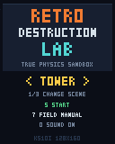
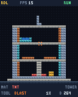
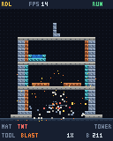

# Retro Destruction Lab — K510i Edition

Двумерная физическая песочница разрушений для **Sony Ericsson K510i** и совместимых J2ME-телефонов. Это настоящий MIDlet на **MIDP 2.0 / CLDC 1.1**, а не браузерная версия или Java SE-приложение.

Все сцены, материалы и инструменты доступны сразу. Нет уровней, валюты, открываемых деталей, сети и покупок.

## Установка на телефон

Готовые файлы находятся в [`release/`](release/):

- **`RetroDestructionLab.jar`** — сама игра;
- **`RetroDestructionLab.jad`** — дескриптор для установки старыми телефонами.

1. Скопируйте **оба файла в одну папку** на карту памяти или в память K510i через USB/Bluetooth.
2. Откройте `RetroDestructionLab.jad` и подтвердите установку. Если прошивка позволяет ставить JAR напрямую, можно открыть JAR.
3. Не переименовывайте файлы: в JAD указано имя `RetroDestructionLab.jar` и его точный размер.
4. Запустите **Retro Destruction Lab** из меню приложений/игр.

Размер JAR — примерно **17 КБ**. Игра не запрашивает доступ к сети, файлам, контактам или сообщениям.

## Управление

| Клавиша | В меню | В игре |
|---|---|---|
| `2`, `4`, `6`, `8` / джойстик | — | Движение курсора |
| `5` / центр джойстика | Начать / назад из справки | Применить инструмент; для Build/Erase работает удержание |
| `1`, `3` | Предыдущая/следующая сцена | Предыдущий/следующий материал |
| `7` | Справка | Следующий инструмент |
| `9` | — | Запуск / пауза симуляции |
| `*` | — | Скорость `1X → 1/2 → 1/4` |
| `#` | — | Заново загрузить текущую сцену |
| `0` | Включить/выключить звук | Следующая сцена |
| Левая софт-клавиша | — | Пауза / продолжить |
| Правая софт-клавиша | — | Главное меню |

**Совет:** ставьте сложные конструкции на паузе, затем нажимайте `9` и наблюдайте расчёт нагрузок.

## Что уже работает

### Инструменты

- **Build** — ставить блоки выбранного материала.
- **Erase** — удалять блоки без взрыва.
- **Spark** — нагревать и поджигать горючие материалы.
- **Blast** — создавать ударный заряд с радиальным затуханием повреждений.

### Материалы

- **Steel** — прочная и тяжёлая несущая сталь.
- **Concrete** — тяжёлый строительный блок с другой прочностью и массой.
- **Wood** — лёгкий, горючий, передаёт жар соседям.
- **Glass** — хрупкое стекло; высокие перегруженные колонны разрушаются под нагрузкой.
- **TNT** — детонирует от повреждения или сильного нагрева и поддерживает цепные реакции.
- **Fuel** — менее мощный заряд с сильным поджогом соседних блоков.
- **Water** — падает, растекается, отнимает тепло и частично испаряется у горячих блоков.

### Сцены

- **Tower** — многоэтажная башня с опорами, стеклом, деревом, резервуаром воды, топливом и TNT.
- **Bridge** — мост с пролётом, опорами и горючей нагрузкой.
- **Empty** — чистый полигон только с несущим основанием.

### Симуляция

- Граф связи блоков с опорами; потерявшие связь элементы отделяются.
- Вертикальная передача собственного веса и постепенное разрушение перегруженных элементов.
- Прочность, повреждения и видимые трещины.
- Радиальные взрывы и отложенные цепные детонации.
- Нагрев, распространение огня и охлаждение водой.
- Обломки на целочисленной fixed-point физике: гравитация, столкновения, отскоки и ударные повреждения.
- Искры, дым, тряска камеры, пауза и замедление.

Модель честно **клеточная и дискретная**, рассчитанная на кнопочный телефон: это не конечно-элементный сопромат и не soft-body современного ПК. Разрушения не проигрываются заготовленной анимацией — каждый кадр является результатом изменения состояния мира.

## Производительность K510i

| Решение | Бюджет |
|---|---|
| Логический экран | `128×160` |
| Мир | `32×32`, 1024 ячейки |
| Частота верхнего предела цикла | 15 Гц |
| Обломки/частицы | До 160; стартовый бюджет 144, адаптивное снижение до 64 |
| Цепные взрывы | До 6 за тик, остальные продолжаются следующими тиками |
| Отделения блоков | До 8 за структурный проход |
| Кадровый буфер | Один постоянный `int[20480]`, около 80 КиБ |
| Вывод | Один `drawRGB` на кадр |

В симуляции и рендере используются заранее выделенные массивы и пулы; игровой цикл не создаёт объекты для блоков, частиц или текста. При продолжительно дорогих кадрах сначала уменьшается число частиц, затем отключаются дополнительные трещины. Физическая модель при этом не меняется.

В левом верхнем углу есть **реальный FPS-счётчик**. Звук можно отключить клавишей `0` в главном меню.

## Сборка из исходников

Требуются Unix-совместимая оболочка, **JDK 8**, `curl` и обычные базовые утилиты. JDK 8 нужен именно для старого `-target 1.2`; новые версии `javac` его уже не поддерживают.

```sh
cd retro-destruction-lab
./tools/fetch-deps.sh
./build.sh
./tests/run-tests.sh
```

Скрипт `fetch-deps.sh` скачивает только compile-time API и ProGuard в игнорируемую папку `lib/`. Они **не включаются** в игровой JAR. Подробности: [`tools/THIRD_PARTY.md`](tools/THIRD_PARTY.md).

Можно задать собственные пути:

```sh
JAVAC=/path/to/javac \
JAVA=/path/to/java \
JAR=/path/to/jar \
J2ME_LIB_DIR=/path/to/j2me-libs \
PROGUARD_JAR=/path/to/proguard.jar \
./build.sh
```

Сборка создаёт классы старого формата, выполняет CLDC-преверификацию ProGuard с `-microedition`, добавляет иконку и формирует JAD с CRLF и точным `MIDlet-Jar-Size`.

## Preview-стенд для проверки JAR

Каталог `preview/` запускает **тот же готовый MIDlet JAR** в `j2me-web` и добавляет виртуальную кнопочную клавиатуру. Игровая логика в Web не переписывается. Нужен современный браузер с WebGPU.

```sh
cd preview
npm install
npm start
```

По умолчанию стенд слушает `0.0.0.0:3000`; порт можно изменить переменной `PORT`. Для установки на телефон по-прежнему используются файлы из `release/`.

## Структура

```text
src/rdl/core/World.java          # Независимая физика; нет MIDP/Java SE зависимостей
src/rdl/platform/LabMidlet.java # Жизненный цикл MIDlet
src/rdl/platform/LabCanvas.java # Ввод, очередь команд, цикл, адаптивное качество
src/rdl/platform/PixelRenderer.java # Программный рендер 128×160
src/rdl/platform/PixelFont.java # Пиксельный шрифт 3×5
src/rdl/platform/Sound.java     # Ограниченные по частоте MMAPI-тона
res/icon.png                    # Индексированная иконка MIDlet
release/                        # Готовые JAR и JAD
tests/                          # Core и renderer regression tests
```

## Проверки

- Core: опоры, отделение блоков, цепная детонация, вода, лимит частиц и перегрузка.
- Renderer: активные пиксели шрифта, все сцены, материалы, инструменты и экран справки.
- Длительный прогон каждой исходной сцены: 300 тиков без самопроизвольных обрушений.
- Проверка JAR: class major 46 и CLDC `StackMap`.
- Запуск готового JAR в J2ME-совместимой VM: старт MIDlet, Canvas, клавиши и взрыв.

**Физический K510i в текущей среде недоступен.** Поэтому цель 10–15 FPS заложена в бюджеты и проверена архитектурно, но реальную частоту именно на телефоне нужно подтвердить отдельно. Чек-лист: [`docs/K510I-TEST.md`](docs/K510I-TEST.md).

## Кадры игры

| Меню | Полигон | Разрушение |
|---|---|---|
|  |  |  |
